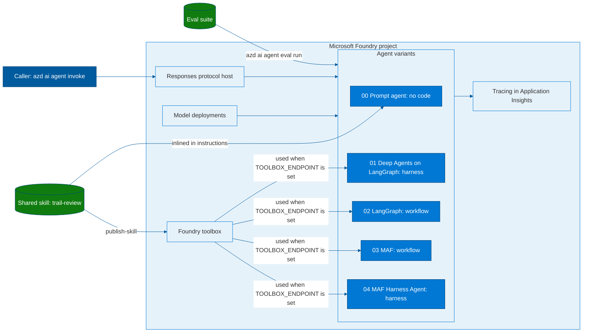

# Foundry agent options

Documentation of how Microsoft Foundry hosted agents and prompt agents work today (October 2026), with working code for both LangChain/LangGraph and Microsoft Agent Framework (MAF). It covers how an agent defined in LangGraph, Deep Agents, or MAF runs as a Foundry hosted agent, how swappable those definitions are, and where a Foundry prompt agent with no code at all fits next to them. It also records what deploying, invoking, evaluating, and tracing each variant involves, *including preview behavior that surprised me.*

This repository is the latest in my [agentic series](#the-agentic-series).

Every variant carries the same feature so the options stay comparable: a trail plan review. The agents review a group hike proposal from a fictional hiking club, Alpenglow Trail Club, against illustrative safety and environment rules, and they return the same structured verdict. The review is the shared workload that exercises the options, and each option is documented in its own folder.

## How the options fit together



## Disclaimer

The club, the proposal, and the rules are fictional, and the rules are illustrative only: they are not real safety guidance. The Azure tooling used here (`azd ai` extensions, hosted agents, toolbox skills) is in preview, so test in your own subscription before relying on any of it. Findings about preview behavior in this README were observed at the time of writing and can change.
## The five variants

| | Harness (the model plans its own steps) | Workflow (code defines the steps) |
|---|---|---|
| **Foundry prompt agent** | [00 Prompt agent](#the-prompt-agent-variant) (Foundry runs the loop, no code) | |
| **LangChain** | [01 Deep Agents on LangGraph](01-langgraph-deepagents/README.md) | [02 LangGraph workflow](02-langgraph-workflow/README.md) |
| **Microsoft Agent Framework** | [04 MAF Harness Agent](04-maf-harness/README.md) | [03 MAF workflow](03-maf-workflow/README.md) |

Every variant is a self-contained azd project in its own folder, so the folders deliberately duplicate some setup.

For a step-by-step explanation with diagrams, see [docs/demo-walkthrough.md](docs/demo-walkthrough.md).

## Shared layers across the variants

| Layer | Across all five variants |
|---|---|
| Domain knowledge | One `trail-review` skill ([`shared/skills`](shared/skills/trail-review/SKILL.md)) in the open Agent Skills `SKILL.md` format. The hosted agents can fetch it from a Foundry toolbox at startup; the prompt agent carries it in its instructions |
| Model | Model deployments in one Foundry project (`gpt-5.4-mini` by default, plus `gpt-6-sol` and `gpt-5.6-sol`), chosen per agent version |
| Hosting | 01-04: Foundry hosted agent, Responses protocol, code deploy, Python 3.13. 00: Foundry prompt agent, Responses protocol, no container |
| Caller | `azd ai agent invoke <name> --input-file <proposal>`, identical apart from the agent name |
| Evaluation | One eval suite ([`evals/`](evals/eval.yaml)) run against every agent with `azd ai agent eval run` |
| Agent definition | Changes per variant: one file (`agent.py`, `main.py`, or the prompt agent's `azure.yaml`) |

The harness variants load the skill through progressive disclosure. The workflow variants read the same skill files into fixed steps. Each hosting wrapper is a few lines: `ResponsesHostServer(graph)` for LangChain and `ResponsesHostServer(agent)` for MAF.

## Layout

```text
foundry-agents-options/
├── demo.ps1                     # same proposal to each agent, side by side
├── docs/demo-walkthrough.md     # Mermaid diagrams for the walkthrough
├── shared/
│   ├── skills/trail-review/   # canonical skill (SKILL.md + references)
│   ├── toolbox_skills.py        # toolbox skill loader, copied into 01-03
│   └── sample/trail-plan.md # fictional proposal (sent by the caller)
├── evals/
│   ├── eval.yaml                # eval suite: dataset + built-in evaluators
│   ├── eval-rubric.yaml         # same, plus the generated rubric evaluator
│   ├── trail-dataset.jsonl      # 6 test proposals with candidate responses
│   ├── evaluators/trail-review/ # rubric dimensions
│   └── agent-instruction.md     # instruction used to generate a suite
├── scripts/
│   ├── deploy.ps1               # deploy all five into one Foundry project
│   ├── publish-skill.ps1        # publish the skill to a Foundry toolbox
│   ├── eval.ps1                 # run the eval suite against each agent
│   ├── enable-tracing.ps1       # connect App Insights for portal traces
│   ├── validate-mermaid.ps1     # parse-check the walkthrough diagrams
│   ├── sync-shared.ps1          # copy shared files into each agent
│   ├── smoke-test.ps1           # offline build check of 01-04
│   └── install-deps-via-wsl.ps1 # dependency install workaround (see below)
├── 00-prompt-agent/             # azure.yaml only (prompt agent)
├── 01-langgraph-deepagents/     # azure.yaml + src/trail-deepagents
├── 02-langgraph-workflow/       # azure.yaml + src/trail-langgraph-workflow
├── 03-maf-workflow/             # azure.yaml + src/trail-maf-workflow
└── 04-maf-harness/              # azure.yaml + src/trail-maf-harness
```

## Prerequisites

- Azure Developer CLI with the `azure.ai.agents` extension 1.0.0-beta.17 or later (`azd extension update --all`)
- `azd config set auth.useAzCliAuth true`, so azd uses the Azure CLI sign-in
- Python 3.13 and uv
- A subscription where you can create a Foundry project in a hosted-agent region (default `swedencentral`), with GlobalStandard quota of 50K tokens per minute for each model in `01-langgraph-deepagents\azure.yaml` (`gpt-5.4-mini`, `gpt-6-sol`, and `gpt-5.6-sol`)
- The Foundry Project Manager role on the project, for code deploy

## One-time setup

1. Install dependencies into each agent's `.venv`:

   ```powershell
   # Normal path, per agent source folder:
   uv venv --python 3.13 .venv; uv pip install -r requirements.txt   # 01, 02
   uv sync                                                          # 03, 04

   # Workaround when Windows cannot reach files.pythonhosted.org (TLS
   # handshake failures): download the Windows wheels through WSL instead.
   pwsh scripts\install-deps-via-wsl.ps1
   ```

2. Sync the shared files and check that the hosted agents build offline. `sync-shared.ps1` copies the skill and the toolbox loader into each agent and regenerates the prompt agent's instructions from the same skill:

   ```powershell
   pwsh scripts\sync-shared.ps1
   pwsh scripts\sync-shared.ps1 -Check   # report drift only
   pwsh scripts\smoke-test.ps1
   ```

3. Sign in with the Azure CLI: `az login`, then `az account set --subscription <subscription-id>`. The first `deploy.ps1` run records that subscription and tenant in each azd environment. Later runs switch to it and stop if the Azure CLI cannot reach it, so a demo project never lands in the wrong subscription.

## Deploy

```powershell
pwsh scripts\deploy.ps1 -WhatIf        # show the azd commands only
pwsh scripts\deploy.ps1                # 01 creates the project; others attach
pwsh scripts\deploy.ps1 -ProjectId <foundry-project-arm-id>   # reuse a project
pwsh scripts\deploy.ps1 -SkipProvision # new agent versions only, no ARM
```

The script first checks the Azure CLI account against the subscription and tenant in the azd environment (or `-Subscription` and `-TenantId`). It sets the subscription, tenant, and region in each azd environment and runs `azd up` in `01-langgraph-deepagents`. It then attaches the other folders to the same project with `azd ai project add --project-id` and runs `azd up` there. Attaching by endpoint fails, because every manifest also declares the shared model deployment. `00-prompt-agent` always deploys last, because a prompt agent needs the project and its model deployments to exist. It ends with `azd ai agent show` for each agent. Re-running the script is safe and redeploys changed code.

`-SkipProvision` runs only `azd deploy` in each folder. Use it once the project exists: it creates new agent versions in about one to two minutes per hosted agent and makes no Azure Resource Manager changes. A full `azd up` also re-applies the Foundry account template, which can take a long time, so prefer `-SkipProvision` for code-only changes.

A first cold call takes about 20-30 seconds per hosted agent.

## Choose the model

Every agent reads its model from one environment variable, `AZURE_AI_MODEL_DEPLOYMENT_NAME`, so the agent code never names a model. The model chooser has three parts:

| Where | What it does |
|---|---|
| `01-langgraph-deepagents\azure.yaml`, `ai-project.deployments` | Declares the model deployments in the shared project: `gpt-5.4-mini`, `gpt-6-sol`, and `gpt-5.6-sol`, each GlobalStandard with 50K tokens per minute. 01 owns the project, so its `azd up` creates them. Each deployment name equals its model name. |
| `scripts\deploy.ps1 -Model` | Sets `AZURE_AI_MODEL_DEPLOYMENT_NAME` in each agent's azd environment before it deploys. Each hosted agent version keeps the value it was deployed with. With several models, every agent gets one version per model in the given order, and the last model becomes the latest version. Names outside the manifest are rejected. |
| `demo.ps1 -Model` | Lists the agent's versions through the project API and calls the newest version pinned to that model with `azd ai agent invoke --version`. Without `-Model` it calls the latest version. Every call prints the version and model it used. |

```powershell
# One version per model; gpt-5.4-mini last so it stays the default.
pwsh scripts\deploy.ps1 -Model gpt-6-sol,gpt-5.6-sol,gpt-5.4-mini

pwsh .\demo.ps1 -Model gpt-6-sol       # every agent with a GPT-6 sol version
pwsh .\demo.ps1 -Model gpt-5.6-sol -Agent 04-maf-harness
pwsh .\demo.ps1                        # latest versions (gpt-5.4-mini)
```

Once the versions exist, switching models takes seconds and needs no redeploy. The prompt agent has no environment variables: azd does not expand `${VAR}` in a prompt agent's `model:` field and sent the literal text as the model name, which failed with HTTP 500. `deploy.ps1` therefore writes each model name into the `model:` line of `00-prompt-agent\azure.yaml` for the duration of that deploy and restores the file afterwards, and `demo.ps1 -Model` reads the model from the prompt agent version's definition. The portal playground and `azd ai agent invoke` without `--version` use the latest version, which is the model deployed last. To add a model, append a deployment to the `ai-project` block in `01-langgraph-deepagents\azure.yaml`, run `azd provision -C 01-langgraph-deepagents`, and deploy with `-Model`. GPT-6 and GPT-5.6 come only in named variants, so list the models your account offers before you pick one. The demo uses the `sol` variant of each; swap in another variant by changing its entry in the manifest.

A local run (`azd ai agent run`) uses the model in the folder's azd environment, which `deploy.ps1` leaves on the last model it deployed.

`gpt-6-sol` rejects a fixed `temperature` parameter, so the agents leave `temperature` at the model default.

## The prompt agent variant

`00-prompt-agent` is a Foundry prompt agent: a model, instructions, and optional tools, defined in `azure.yaml` and run by Foundry Agent Service itself. It has no code, container, or dependencies. `azd deploy` creates a new version in about ten seconds, and the first call answers in about ten seconds because no container has to start.

Foundry owns the agent loop, so a prompt agent suits a review that needs no custom steps. The hosted variants exist for the opposite case: code that must decide or enforce steps (a workflow), or an open-source framework the team already uses. Hosted agents add a runtime charge for the CPU and memory their sessions consume while active, on top of model tokens and tools ([Hosted agents in Foundry Agent Service](https://learn.microsoft.com/en-us/azure/foundry/agents/concepts/hosted-agents#pricing)). For current rates of both agent types, see the [Foundry Agent Service pricing page](https://azure.microsoft.com/pricing/details/foundry-agent-service/).

The prompt agent's instructions carry the whole `trail-review` skill: `sync-shared.ps1` writes `SKILL.md` (without its front matter) and both reference files into the `instructions:` block of `azure.yaml`. The skill stays one source for all five variants. Foundry prompt agents can also attach skills and toolboxes directly, but at the time of writing that needed the `github_copilot_preview` harness, which may not be enabled for your subscription. A prompt agent without a harness accepted a `skills:` entry in its definition and then could not read the skill at run time, so the demo inlines it instead.

Expect the prompt agent to answer in about 10 seconds, because no container has to start.

## Skills from a Foundry toolbox

A Foundry toolbox bundles tools and skills behind one MCP endpoint that any agent can connect to. The hosted variants can load the `trail-review` skill from a toolbox at startup instead of from the copy in their code package. The skill is then published once and changed without redeploying any agent.

| Variant | How it reads the toolbox skill |
|---|---|
| 01, 02, 03 | `toolbox_skills.py` reads `skill://index.json` from the toolbox MCP endpoint, downloads each skill archive, and unpacks it into a temporary `skills` folder that the agent code then reads as before |
| 04 | MAF's native `FoundryToolbox` connects to the toolbox, and `toolbox.as_skills_provider()` hands its skills to the harness agent |
| 00 | Not used; the prompt agent carries the skill in its instructions (see above) |

Every hosted variant reads the toolbox URL from `TOOLBOX_ENDPOINT`. When it is empty, 01-03 use the bundled skill and print `[toolbox_skills] Skills source: bundled` to the console log (`azd ai agent monitor`), and 04 uses its bundled skill folder. When it is set, 01-03 print `Skills source: toolbox <url>`. If the toolbox cannot be read, 01-03 fall back to the bundled skill and say so in the log; 04 does not start, because it opens the toolbox connection before it starts serving.

```powershell
pwsh scripts\publish-skill.ps1                  # publish, attach, set env
pwsh scripts\deploy.ps1 -SkipProvision          # agents pick up the env var
pwsh scripts\publish-skill.ps1 -Clear           # back to bundled skills
```

`publish-skill.ps1` creates or updates the Foundry skill from `shared\skills\trail-review` (each update becomes the new default version), creates the toolbox `trail-toolbox` with that skill if it does not exist, and sets `TRAIL_TOOLBOX_ENDPOINT` in the azd environments of 01-04. Their `azure.yaml` maps that value to `TOOLBOX_ENDPOINT`.

The agents read the skill once when their session sandbox starts, and 04 caches it after the first request. A new skill version therefore reaches an agent when a new session starts or after a redeploy. An idle session releases its compute after the idle timeout (15 minutes by default), and the next request starts fresh compute. No agent code changes.

Where the skill lives: `publish-skill.ps1` publishes to the agents' own project by default, and `-ProjectEndpoint <url>` picks another Foundry project. When the toolbox sits in a different Foundry resource than the agents, `publish-skill.ps1` grants each agent's instance identity the Foundry User role on that resource, and the agents read it across regions with their own Microsoft Entra agent identity. Once the skill sits next to the agents, the role grant is no longer needed.

The toolbox MCP endpoint serves skills as resources only; its `tools/list` call returns an error unless the caller names tools, so the loader reads resources directly.

## Enable traces

The project has no Application Insights connection after `azd up`, so the portal's **Traces** tab shows "Not connected". Connect it once, then redeploy so the agents pick up the connection:

```powershell
pwsh scripts\enable-tracing.ps1   # workspace + App Insights + project connection
pwsh scripts\deploy.ps1           # redeploy so agents export to App Insights
```

`enable-tracing.ps1` creates a Log Analytics workspace (`log-trail-<suffix>`) and a workspace-based Application Insights resource (`appi-trail-<suffix>`) in the project's resource group. It then adds an `AppInsights` connection to the Foundry project, the same connection the portal's **Connect** button creates. After that, Foundry injects `APPLICATIONINSIGHTS_CONNECTION_STRING` into the hosted agent containers, and the hosting libraries export OpenTelemetry traces without code changes. A call made after connecting but before redeploying produced no telemetry in testing.

The **Trace ID** that `azd ai agent invoke` prints is the W3C trace ID of the request. It equals `OperationId` in Application Insights, and you can paste it into the portal's Traces search. Each trace holds the platform `invoke_agent` span, the agent's model calls (`chat gpt-5.4-mini`), and tool calls such as `execute_tool load_skill` in the harness variants. Allow two to five minutes for ingestion.

### What the traces show per variant

One `demo.ps1` run produces one trace per agent. Records are all rows in Application Insights with the request's Trace ID (spans plus log lines). The shape differs per variant:

| Agent | Model calls | Tool calls in the agent |
|---|---|---|
| `trail-deepagents` (harness) | A few, decided by the model | A batch of file reads for the skill files |
| `trail-langgraph-workflow` (workflow) | 3, one per node | None |
| `trail-maf-workflow` (workflow) | 3, one per executor | None |
| `trail-maf-harness` (harness) | One per tool round, plus the answer | `load_skill`, then `read_skill_resource` |

How to read the traces:

- The workflows made three model calls in a fixed order in all six of my runs, because the graph defines the steps. Two of the six traces also carried duplicate spans from a second instrumentation layer reporting the same calls.
- The harnesses decide their own steps. Each run starts with a model call, which then asks for tool calls to read the skill files, and ends with the answer. The number and order of tool calls can change between runs: Deep Agents used one tool round in two of three runs and four tool calls in the third, while the MAF harness followed the same sequence in all three. The span listings are in [docs/trace-logs.md](docs/trace-logs.md).
- Deep Agents produces many more records than the others, mostly from infrastructure. The largest share is Azure Identity log lines about managed identity tokens. Deep Agents also runs with the Foundry checkpointer, which saves graph state to Foundry storage after each step and keeps the graph state across turns of the same session.
- To compare reasoning, filter the trace to `chat` and `execute_tool` spans and ignore the HTTP and log rows.

### Metadata endpoint errors

Early traces can show `requests.exceptions.ConnectionError` to `169.254.169.254` in `AppExceptions`. The Azure Monitor exporter's own usage telemetry (statsbeat) probes the Azure VM metadata endpoint, which does not exist in a hosted container. The error has no effect on the agents. Every `azure.yaml` sets `APPLICATIONINSIGHTS_STATSBEAT_DISABLED_ALL: "true"`, which turns statsbeat off.

### Application Insights cost

Application Insights bills through its Log Analytics workspace, which uses the pay-as-you-go tier (`PerGB2018`) with no daily cap. Each billing account gets 5 GB of free ingestion per month, and Application Insights tables keep data for 90 days at no extra charge. A handful of demo runs ingests only a small volume, mostly log lines, dependency spans, and captured prompt and response content (`AppGenAIContent`). Performance counters keep arriving while agent containers are warm. For current per-GB prices, see the [Azure Monitor pricing page](https://azure.microsoft.com/pricing/details/monitor/).

Traces capture prompt and response content. The demo uses a fictional proposal only; apply your data classification rules before you send real documents.

`azd down` in `01-langgraph-deepagents` deletes the resource group, which removes the workspace and Application Insights along with the project.

## Run the trail plan review

```powershell
pwsh .\demo.ps1                                   # all five agents
pwsh .\demo.ps1 -Agent 01-langgraph-deepagents, 04-maf-harness
```

To run one agent locally, start it with `azd ai agent run -C <folder>` (this also opens Agent Inspector), then call `pwsh .\demo.ps1 -Local -Agent <folder>` from another terminal. The prompt agent has no local mode, so `-Local` skips it.

`demo.ps1` sends the proposal as a Responses request body with `azd ai agent invoke --input-file`. A multi-line positional message loses everything after its first line on the way from azd to the agents extension. To see what a hosted agent did, run `azd ai agent monitor <name> -C <folder>` for its console log.

Model output varies between runs. A variant may occasionally rate one rule as `concern` instead of `pass` or `fail`, but the overall verdict should stay **Reject**.

## Where the proposal comes from

Each hosted agent's code package contains its code and a copy of the `trail-review` skill (`SKILL.md` plus the two rule files in `references/`). With `TOOLBOX_ENDPOINT` set, the agents use the toolbox copy instead and keep the bundled one as a fallback (01-03). The prompt agent carries the skill in its instructions. The sample proposal in `shared/sample/trail-plan.md` stays outside every `src/` folder, so it is never deployed. The caller sends the proposal text in each request: `demo.ps1` reads the file and puts its content in the request body.

This explains what happens in the Foundry portal playground. The agent always has the rules, so it answers any prompt with a review. When the prompt holds no proposal, for example a line copied from `SKILL.md`, the skill's rule applies: "If the proposal says nothing about a rule, write `No evidence in proposal` and use `concern`". The result is six `concern` rows and **Approve with conditions**. To get the real review in the playground, paste the full text of `shared/sample/trail-plan.md` as the message.

## Expected result

The sample proposal has a known answer, so the five outputs can be compared against it.

| Rule | Expected verdict | Reason in the proposal |
|---|---|---|
| S1 | fail | 11:00 start, 22 km at 3 km/h, finishes about 18:20, sunset 18:40 |
| S2 | fail | No emergency exit named, no mobile signal on the ridge |
| S3 | fail | 30 participants and 2 leaders, 4 are needed |
| E1 | fail | No reserve permit, and the group may leave the marked path |
| E2 | concern | No statement on how waste is handled |
| E3 | fail | 30 participants through an alpine meadow, the limit is 12 |

Overall verdict: **Reject**.

## Evaluate the variants

One sample proposal shows that the agents work. An eval suite shows how well they work across many proposals, and it makes the variants comparable. The suite uses the beta `azd ai agent eval` commands.

| Step | Command | Result |
|---|---|---|
| Use the bundled suite | `evals\trail-dataset.jsonl` | Six test proposals with candidate responses, covering each rule and the sample proposal |
| Generate a larger suite | `azd ai agent eval generate --gen-instruction-file evals\agent-instruction.md` | Foundry writes test proposals from the agent's instructions and generates a rubric evaluator with weighted dimensions (`evals\evaluators\trail-review`) |
| Run it per agent | `pwsh scripts\eval.ps1` (wraps `azd ai agent eval run --agent <name>`) | Foundry sends every test proposal to the agent and scores each answer; the report link opens the run in the portal |
| Inspect a run | `azd ai agent eval show --eval-run-id <id>` | Pass, fail, and error counts per evaluator |

`evals\eval.yaml` scores with two built-in evaluators, task adherence and intent resolution. `evals\eval-rubric.yaml` adds the `trail-review` rubric, whose seven weighted dimensions include rule assessment accuracy (weight 9), grounded specificity, missing-information detection, and decision quality. A rubric evaluator must be registered in the project before a run can use it (`azd ai agent eval update --evaluator-only`).

```powershell
pwsh scripts\eval.ps1                                # built-ins, all five
pwsh scripts\eval.ps1 -Agent 00-prompt-agent -Rubric # with the rubric
pwsh scripts\eval.ps1 -Generate                      # regenerate the suite
```

`eval.ps1` gives every agent its own temporary copy of the config, because `eval run` writes the agent name and version back into the file it reads.

The test proposals test rule coverage (for example "no mobile signal statement" for S2). For a trial, add real proposals with the expected verdict from a human reviewer as a golden dataset, and pass it with `azd ai agent eval generate --dataset <file>`. Once a run succeeds, the same `eval.yaml` can feed `azd ai agent optimize` (preview), which proposes prompt changes and leaves applying them to you.

## Debug with F5 breakpoints

In VS Code, F5 starts the selected debug configuration. A breakpoint is a marker that you set by clicking left of a line number. When execution reaches that line, the program pauses so you can inspect variables, the call stack, and the state flowing through the agent, then step through or continue.

[`.vscode/launch.json`](.vscode/launch.json) contains one configuration per variant. Each one starts the local agent server under the Python debugger on port 8088.

1. Create `.env` in the agent's source folder from `.env.example`, and set `FOUNDRY_PROJECT_ENDPOINT` (shown by `azd ai project show -C <folder>`).
2. Open this folder in VS Code, set a breakpoint (for example in a workflow node), pick the configuration in Run and Debug, and press F5.
3. Run the task **Open Agent Inspector (port 8088)**, or `azd ai inspector launch`, and send a request. Execution stops at the breakpoint.

## Tooling notes

- The `azd ai` extensions are beta. Verified with azd 1.34.2 and `azure.ai.agents` 1.0.0-beta.17. Test the full deploy in your own subscription first, and pin the extension versions once it works.
- `agent-framework-foundry-hosting` is a prerelease package. `create_harness_agent` is released; its background agents, file access, and looping remain experimental.
- MAF skill tools require approval by default. The harness variant auto-approves only `load_skill` and `read_skill_resource`.
- `ResponsesHostServer` owns conversation history and refuses any other history provider that loads messages. The harness always installs one, so 04 passes the host's own per-request buffer (source id `_foundry_responses_history`) as its `history_provider`.
- The hosted container's working directory (`/app`) is read-only, so 04 disables the harness file memory, which would write there.
- In 02, the Responses host streams every model call in the graph. The two reviewer calls carry LangGraph's `nostream` tag, so the client sees only the summarizer's answer.
- 01 and 02 keep the samples' locked `requirements.txt`, so 01 still installs a few packages that only the sample's removed web search toolbox used.
- 01 (`utils.py`) and 02 (`main.py`) leave `temperature` at the model default, as the MAF variants do. `gpt-6-sol` rejects the `temperature` parameter with HTTP 400, so a fixed `temperature=0.0` broke the LangChain variants on that model.
- `azd ai agent invoke --version N` derives the protocol only for the version recorded in the azd environment (the latest deploy), so `demo.ps1 -Model` also passes `--protocol responses`.
- The folders were scaffolded with `azd ai agent init -m <sample azure.yaml>` from the Foundry samples catalog (`azd ai agent sample list`).

## The agentic series

This repository is part of a series of agentic projects. The list below is not in order of release date.

- [tibco-bw-copilot-agentic-analysis](https://github.com/henrybravo/tibco-bw-copilot-agentic-analysis): AI-assisted analysis of TIBCO BusinessWorks 5.15 exports using GitHub Copilot and spec-driven development patterns.
- [langgraph-foundry-performance-lab](https://github.com/henrybravo/langgraph-foundry-performance-lab): a LangGraph agent with two-model routing, native tool calling, and per-call instrumentation for benchmarking Azure AI Foundry model latency and token usage.
- [lending-underwriting-uat-agent](https://github.com/henrybravo/lending-underwriting-uat-agent): part of a series of AI agents that automate code reviews, backlog refinement, or software delivery workflows.
- [agentic-azure-blueprint](https://github.com/henrybravo/agentic-azure-blueprint): a spec-driven, agentic Azure application shell with a Next.js frontend, a FastAPI BFF, and a LangGraph orchestrator on three Azure Container Apps wired by .NET Aspire, deployed with azd and driven by the spec2cloud workflow.
- foundry-agents-options (this repository): the hosted and prompt agent options on Microsoft Foundry with LangGraph and MAF.
## Sources

- Microsoft Foundry samples, Python hosted agents: the four starting samples and their `azure.yaml` manifests. https://github.com/microsoft-foundry/foundry-samples/tree/main/samples/python/hosted-agents
- Microsoft Learn, Hosted agents in Foundry Agent Service: hosting model, protocols, and region availability. https://learn.microsoft.com/en-us/azure/foundry/agents/concepts/hosted-agents
- Microsoft Learn, Create hosted agents with Foundry Toolkit for Visual Studio Code: Agent Inspector, F5 debugging, and code deploy. https://learn.microsoft.com/en-us/azure/foundry/how-to/develop/vs-code-agents-workflow-pro-code
- Microsoft Learn, Agent Framework Agent Harness: `create_harness_agent` options and release status. https://learn.microsoft.com/en-us/agent-framework/concepts/harness
- Microsoft Learn, Agent Framework Agent Skills: progressive disclosure and skill tools. https://learn.microsoft.com/en-us/agent-framework/agents/skills
- LangChain docs, Deep Agents skills: `skills` parameter and `FilesystemBackend`. https://docs.langchain.com/oss/python/deepagents/skills
- Agent Skills specification: the shared `SKILL.md` format. https://agentskills.io/specification
- Microsoft Learn, Set up tracing in Microsoft Foundry: connecting Application Insights and searching traces by Trace ID. https://learn.microsoft.com/en-us/azure/foundry/observability/how-to/trace-agent-setup (fetched 2026-09-28)
- Microsoft Learn, Export hosted agent telemetry by using OpenTelemetry: Foundry injects `APPLICATIONINSIGHTS_CONNECTION_STRING` when project monitoring is enabled. https://learn.microsoft.com/en-us/azure/foundry/agents/how-to/configure-hosted-agent-telemetry (fetched 2026-09-28)
- Microsoft Learn, Application Insights FAQ: billing through the Log Analytics workspace and 5 GB free per billing account per month. https://learn.microsoft.com/en-us/azure/azure-monitor/app/application-insights-faq#what-is-the-application-insights-pricing-model (fetched 2026-09-29)
- Microsoft Learn, Manage data retention in a Log Analytics workspace: Application Insights tables keep data for 90 days at no charge. https://learn.microsoft.com/en-us/azure/azure-monitor/logs/data-retention-configure#log-tables-with-90-day-default-retention (fetched 2026-09-29)
- Azure Monitor pricing: current per-GB ingestion and retention prices. https://azure.microsoft.com/pricing/details/monitor/
- Microsoft Learn, Hosted agents in Foundry Agent Service: when to choose hosted over prompt agents, agent identity, idle timeout (15 minutes by default), and CPU and memory billing per active session. https://learn.microsoft.com/en-us/azure/foundry/agents/concepts/hosted-agents (fetched 2026-09-29)
- Foundry Agent Service pricing: current rates for prompt and hosted agents. https://azure.microsoft.com/pricing/details/foundry-agent-service/
- Microsoft Learn, Run agent evaluations with the azd CLI (preview): `eval generate`, `eval run`, `eval update`, `eval.yaml`, and prompt agent targets. https://learn.microsoft.com/en-us/azure/foundry/observability/how-to/azure-developer-cli-evaluation (fetched 2026-09-29)
- Microsoft Learn, Curate intent-based toolbox in Foundry: toolbox MCP endpoint and attached skills. https://learn.microsoft.com/en-us/azure/foundry/agents/how-to/tools/toolbox (fetched 2026-09-29)
- Microsoft Learn, Skills in Foundry Agent Service: skill versions and how agents consume them. https://learn.microsoft.com/en-us/azure/foundry/agents/how-to/tools/skills (fetched 2026-09-29)
- Microsoft Learn, Agent Framework Foundry Toolbox: `FoundryToolbox` and its skills provider. https://learn.microsoft.com/en-us/agent-framework/integrations/by-component/tools/foundry-toolbox (fetched 2026-09-29)
- Microsoft Learn, Hosted agent permissions: role assignments for the agent identity beyond the defaults. https://learn.microsoft.com/en-us/azure/foundry/agents/concepts/hosted-agent-permissions (fetched 2026-09-29)
- Henry Bravo, agentic series repositories: the four related projects listed in the agentic series section. https://github.com/henrybravo?tab=repositories
