# Foundry agent options: walkthrough diagrams

These diagrams explain the demo step by step. The demo answers one question: what changes, and what stays the same, when the same trail plan review agent is built as a harness or as a workflow, with LangGraph or with Microsoft Agent Framework, and hosted as a Foundry hosted agent. A fifth variant runs the same review as a Foundry prompt agent without code, as the baseline for that choice.

All five agents review the same fictional group hike proposal from the Alpenglow Trail Club against the same illustrative rules. The rules are demo content and carry no safety or legal meaning.

## 1. The five variants

Two independent choices produce the four hosted agents. The framework choice is LangGraph or Microsoft Agent Framework. The control choice is a harness, where the model plans its own steps, or a workflow, where code fixes the steps. The prompt agent sits before both choices: Foundry runs its loop, and the agent is only a model, instructions, and the skill text.

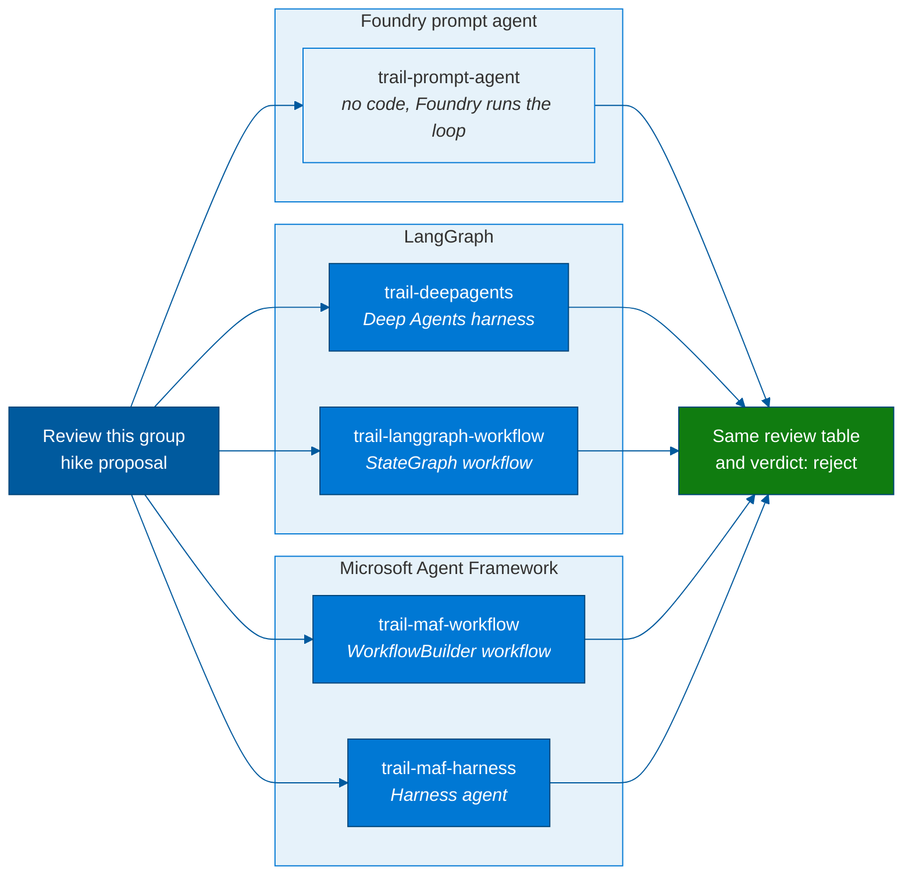

| | Harness: the model plans the steps | Workflow: code fixes the steps |
|---|---|---|
| Foundry prompt agent | `trail-prompt-agent` (Foundry's own loop) | |
| LangGraph | `trail-deepagents` | `trail-langgraph-workflow` |
| Microsoft Agent Framework | `trail-maf-harness` | `trail-maf-workflow` |

## 2. Shared layers across the variants

Everything around the agent code is shared. One skill holds the review rules, one set of model deployments serves all five agents, one Foundry project hosts them, and one client command calls them. The agent name is the only difference in the call. The hosted agents can read the skill from a Foundry toolbox (diagram 9), and the prompt agent carries it in its instructions.

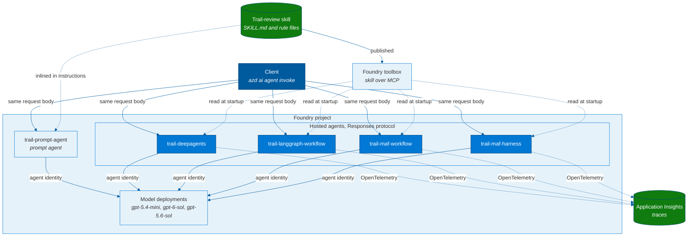

| Shared element | Value in the demo |
|---|---|
| Skill | `trail-review`, in the open Agent Skills `SKILL.md` format; served by a Foundry toolbox to the hosted agents, with a bundled copy as fallback |
| Model | `gpt-5.4-mini` by default, with `gpt-6-sol` and `gpt-5.6-sol` as alternatives, all GlobalStandard |
| Hosting | Foundry hosted agents, Responses protocol, code deploy on Python 3.13; one Foundry prompt agent |
| Client | `azd ai agent invoke <name> --input-file <request>` |
| Evaluation | One eval suite run against every agent (diagram 10) |
| Observability | One Application Insights resource connected to the project |

## 3. Workflow variants: code fixes the steps

Both workflows run three model calls in a fixed order. A safety reviewer checks the safety rules, an environment reviewer checks the environment rules, and a summarizer combines both into the review table and verdict. The code reads the rule files and places them in each reviewer's prompt. The graph is written in code, so every run follows the same path.

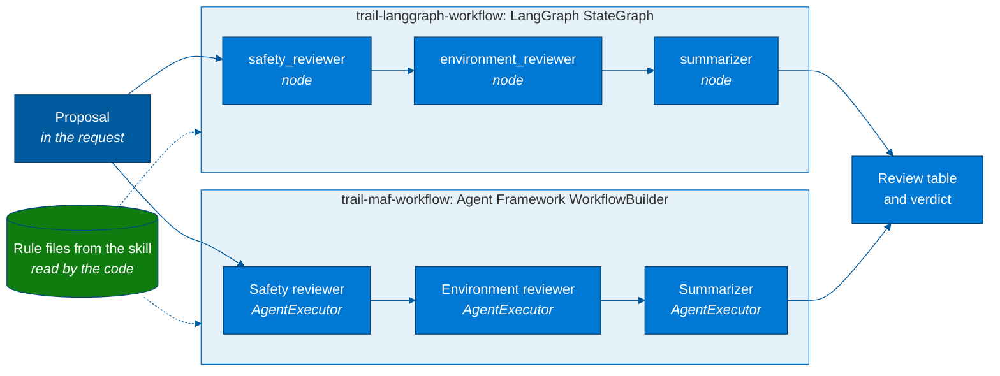

The two workflows map concept for concept:

| Concept | LangGraph | Microsoft Agent Framework |
|---|---|---|
| Step | Node function | `AgentExecutor` wrapping an `Agent` |
| Order | `add_edge` on a `StateGraph` | `add_edge` on a `WorkflowBuilder` |
| Context between steps | Typed graph state | Full conversation passed on (`context_mode="full"`) |
| Final output | Summarizer node | `output_executors=[summarizer]` |
| Hosting adapter | `langchain_azure_ai` Responses host | `agent_framework_foundry_hosting` Responses host |

## 4. Harness variants: the model plans the steps

Both harnesses get one instruction: use the `trail-review` skill. The model sees the short skill description, decides to load the full skill, reads the two rule files it references, and then writes the review. This pattern is called progressive disclosure. The number and order of tool calls can change from run to run. The Agent Framework harness typically follows the sequence below, while Deep Agents can read all three files in one parallel tool round and need fewer model calls.

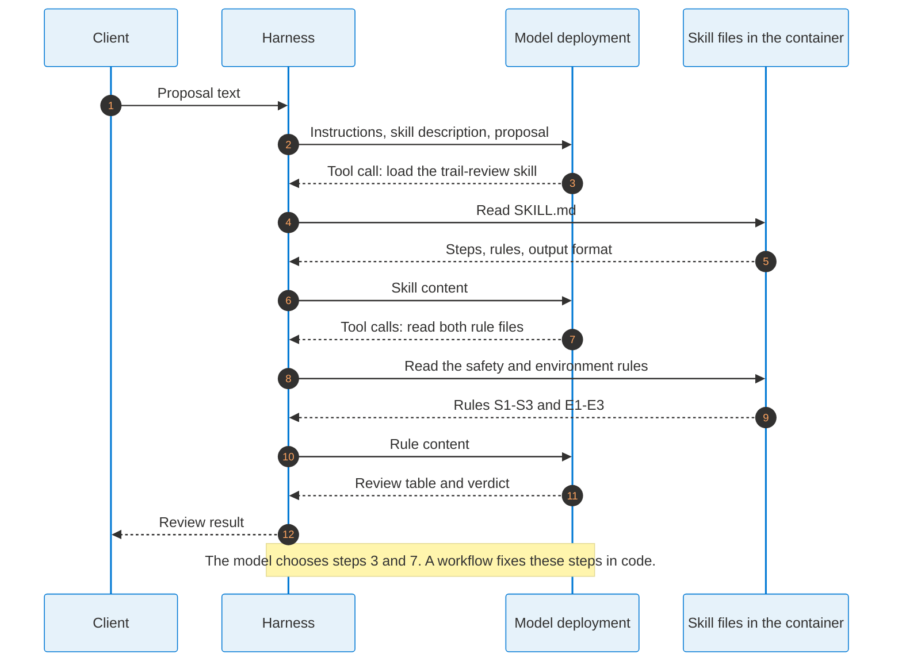

| Concept | Deep Agents on LangGraph | Microsoft Agent Framework harness |
|---|---|---|
| Entry point | `create_deep_agent` | `create_harness_agent` |
| Skill discovery | `skills=["/skills/"]` on a `FilesystemBackend` in virtual mode | `skills_paths=[...]` |
| Skill tools | File tools such as `read_file` | `load_skill`, `read_skill_resource` |
| Tool approval | File reads run without approval | Skill tools need approval by default; the demo auto-approves the read-only ones |
| Session state in Foundry | `FoundryCheckpointSaver` stores graph state | The Foundry host owns the conversation history |

## 5. What gets deployed and what the caller sends

`azd up` packages each agent's source folder, including its copy of the skill, and deploys it as a new hosted agent version. The proposal stays with the caller, who sends it in every request. This explains why a playground prompt without a proposal returns six `concern` rows and the verdict approve with conditions.

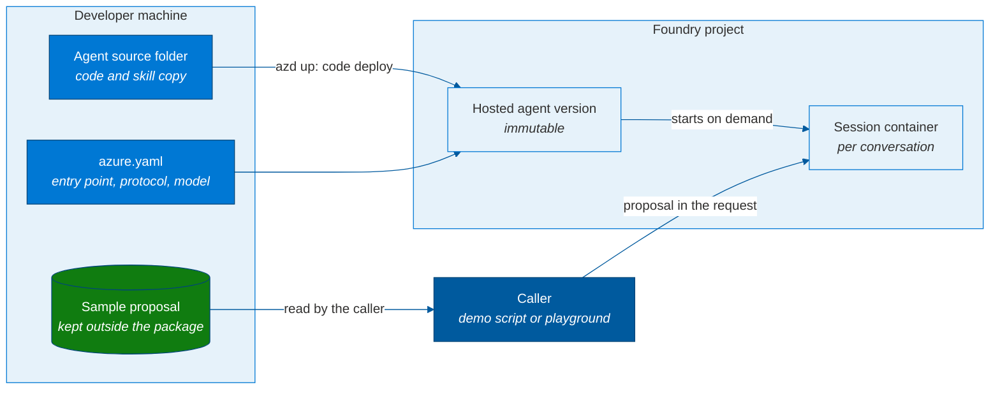

## 6. One request through Foundry hosting

The hosting path is identical for the four hosted agents. Foundry authenticates the caller, routes the request to a session container for the agent version, and stores the response and conversation history. The framework code runs inside the container behind a Responses protocol adapter. Only the framework code differs between the variants. The prompt agent skips the container: Foundry calls the model with the agent's instructions itself.

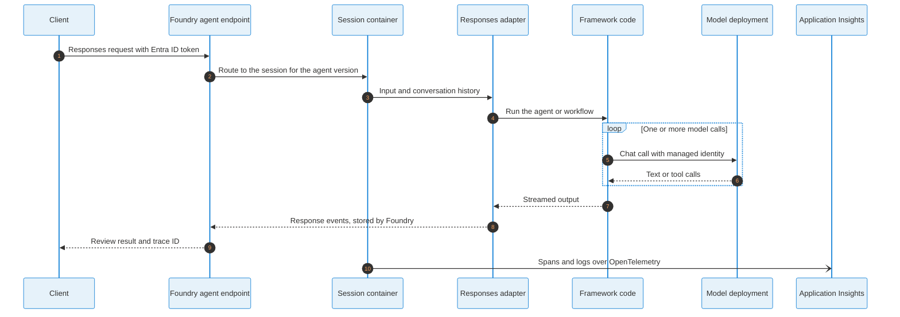

## 7. Swapping LangGraph and Microsoft Agent Framework

A framework swap touches one layer: the agent code and the entry point in its `azure.yaml`. The skill, model deployment, Foundry project, Responses protocol, client call, and tracing all stay as they are. Switching between a harness and a workflow is a design change in the same layer.

A model swap is smaller still: a configuration value. Each agent reads its model deployment name from one environment variable, and every hosted agent version keeps the model it was deployed with. The demo deploys one version per model, so the caller picks `gpt-5.4-mini`, `gpt-6-sol`, or `gpt-5.6-sol` by agent version at call time, and the agent code stays the same.

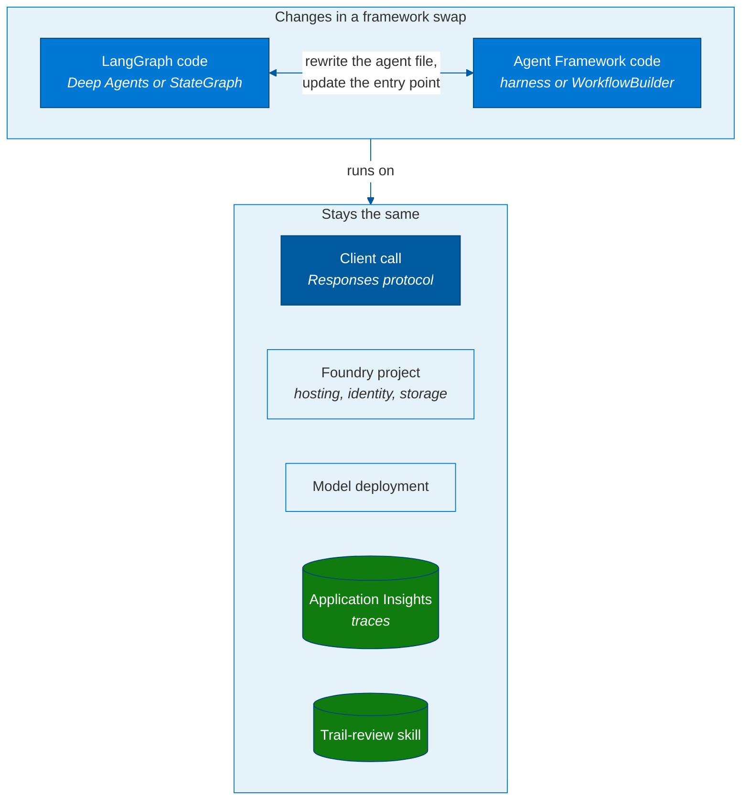

## 8. Reading the traces

Every call returns a trace ID. Paste it into the Traces view of the agent in the Foundry portal, or search for it as `OperationId` in Application Insights. Typical shapes are described below.

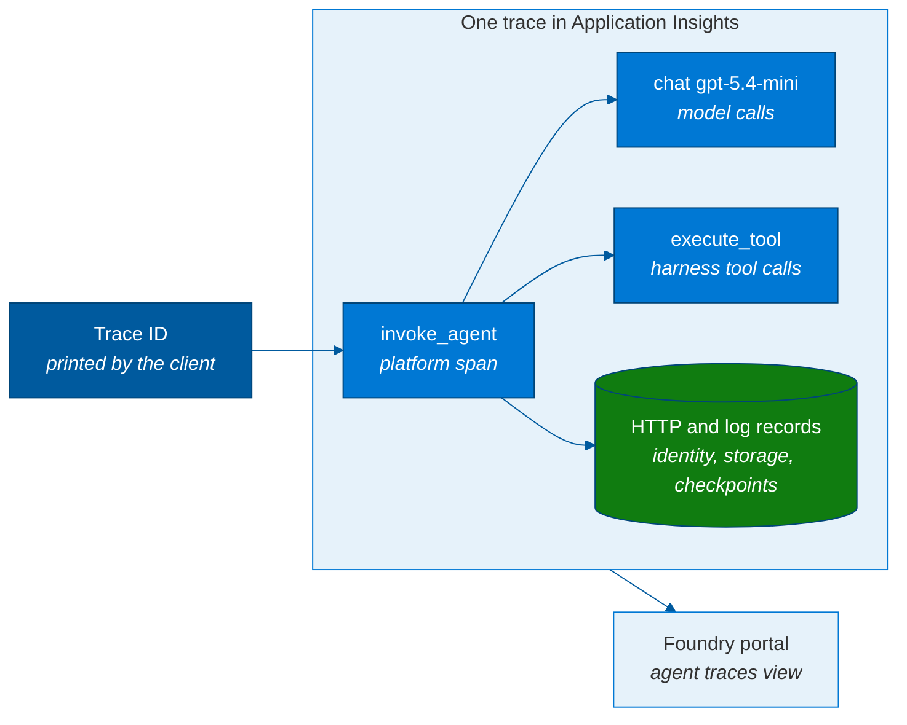

The shapes below come from three runs of each hosted agent on 13 Oct 2026 (swedencentral, `gpt-5.4-mini`). The span listing for every run is in [trace-logs.md](trace-logs.md).

| Agent | Model calls | Tool calls | What the traces showed in three runs |
|---|---|---|---|
| `trail-langgraph-workflow` | 3 | None | Three model calls in every run |
| `trail-maf-workflow` | 3 | None | Three model calls in every run |
| `trail-deepagents` | Fewer, when file reads are batched | 1, 1, and 4 | One parallel tool round in two runs, four tool calls in the third |
| `trail-maf-harness` | One per tool round, plus the answer | 4, 4, and 4 | `load_skill`, then a parallel call with two `read_skill_resource` reads, in every run |

Compare `chat` and `execute_tool` spans to compare reasoning. Two things can make a trace look busier than the agent's real work:

- A second instrumentation layer sometimes reports the same model calls again, as plain `chat gpt-5.4-mini` spans next to the date-suffixed ones. It happened in two of the six workflow traces and in every MAF harness trace, so the "chat calls" chip in the portal can read higher than the number of model calls.
- `HTTP` spans for tokens, storage, and checkpoints outnumber the model and tool spans.

### The same traces in the Foundry portal

Same framework family, different loop owner. The workflow makes three chat calls and no tool calls:

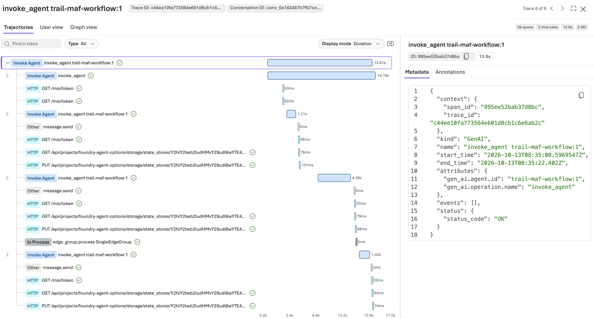

*`trail-maf-workflow`, trace `c44ee10f...`: three chat calls and no tool calls.*

The harness chooses its own tool calls. It loads the skill, then reads two rule files:

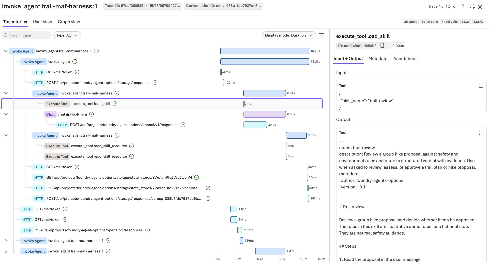

*`trail-maf-harness`, trace `97caf068...`: `load_skill`, then two `read_skill_resource` reads, with 4 chat calls and 4 tool calls.*

The Graph view shows the same workflow shape as a graph, one `invoke_agent` step per node and one chat call under each:

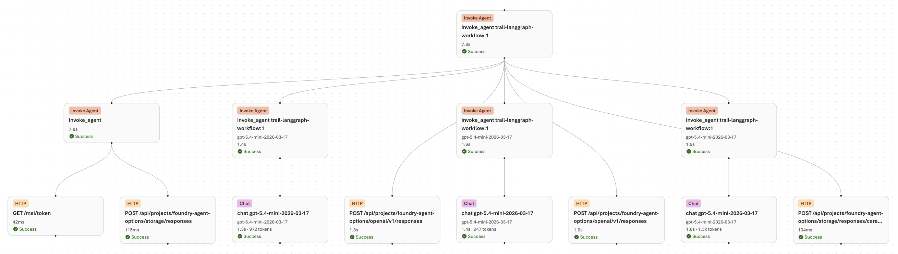

*`trail-langgraph-workflow`, trace `e68b8589...`, Graph view.*

Deep Agents varied its steps. Here are two runs of the same agent, with one parallel tool round and with four tool calls:

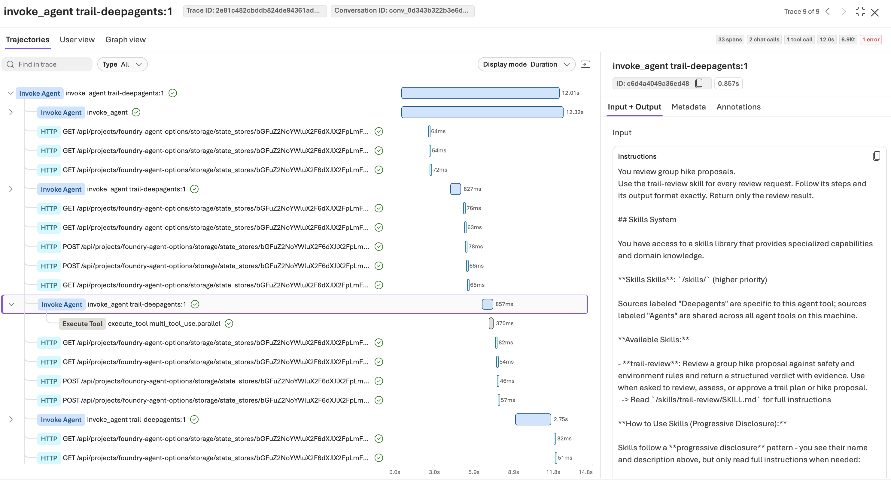

*`trail-deepagents`, trace `2e81c482...`: 2 chat calls and one parallel tool call.*

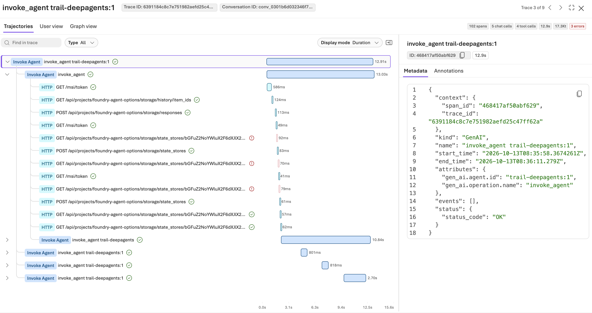

*`trail-deepagents`, trace `6391184c...`: four tool calls. The 5 chat spans include duplicates from the second instrumentation layer.*

The red error markers on the Deep Agents traces are `404` responses on `GET .../state_stores/...`, each followed by a `201` create. Our reading is that the Foundry checkpointer finds no saved state for a brand-new session. Application Insights records these requests as successful and the agent run completed, but the portal flags 4xx responses as errors.

## 9. Skills from a Foundry toolbox

The skill is published once to a Foundry toolbox, which serves it over MCP. Each hosted agent reads it when its session starts, with its own agent identity. Publishing a new skill version changes the rules for every agent without a redeploy; each agent picks it up in its next new session. The toolbox can live in a different Foundry project than the agents, which is useful when the Skills API preview is not yet available in the region of the agent project.

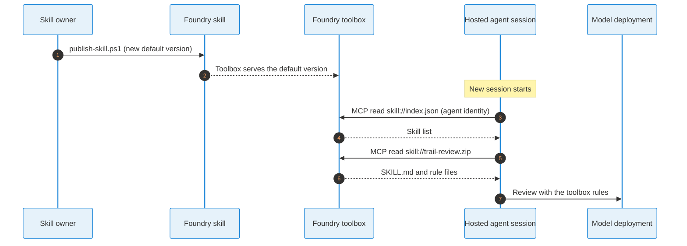

| Variant | How it reads the toolbox skill | If the toolbox is unreachable |
|---|---|---|
| 01, 02, 03 | A small loader downloads the skill into a local folder; the agent code reads it as before | Falls back to the skill copy in the package and logs it |
| 04 | Agent Framework's `FoundryToolbox` hands the toolbox skills to the harness | Does not start |
| 00 | Skill text in the prompt agent's instructions | Not applicable |

## 10. Evaluating the variants

One sample proposal shows that the agents work. An eval suite scores each agent on many proposals, so the variants and models can be compared on numbers. The beta `azd ai agent eval` commands generate the suite from the agent's instructions and run it against each agent.

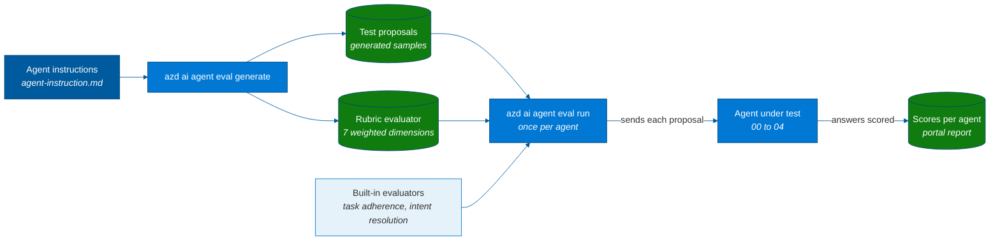

For a trial, the generated proposals become a starting point next to real anonymized proposals with a human reviewer's verdict.

## 11. Exploring the demo yourself

The steps below follow the diagrams in a practical order. The README in the repository root lists the commands for deploying, running, tracing, and evaluating the agents.

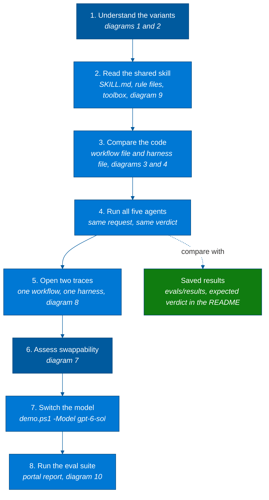

## Sources

- Microsoft Learn, Hosted agents in Foundry Agent Service: hosting model, sessions, and the Responses protocol. https://learn.microsoft.com/en-us/azure/foundry/agents/concepts/hosted-agents
- Microsoft Learn, Set up tracing in Microsoft Foundry: connecting Application Insights and searching traces by trace ID. https://learn.microsoft.com/en-us/azure/foundry/observability/how-to/trace-agent-setup (fetched 2026-09-28)
- Microsoft Learn, Export hosted agent telemetry by using OpenTelemetry: telemetry export from hosted agent containers. https://learn.microsoft.com/en-us/azure/foundry/agents/how-to/configure-hosted-agent-telemetry (fetched 2026-09-28)
- Microsoft Learn, Agent Framework Agent Harness: `create_harness_agent` and its options. https://learn.microsoft.com/en-us/agent-framework/concepts/harness
- Microsoft Learn, Agent Framework Agent Skills: progressive disclosure and the skill tools. https://learn.microsoft.com/en-us/agent-framework/agents/skills
- LangChain docs, Deep Agents skills: the `skills` parameter and `FilesystemBackend`. https://docs.langchain.com/oss/python/deepagents/skills
- Agent Skills specification: the `SKILL.md` format. https://agentskills.io/specification
- Microsoft Foundry samples, Python hosted agents: the starting samples for all four hosted agents. https://github.com/microsoft-foundry/foundry-samples/tree/main/samples/python/hosted-agents
- Microsoft Learn, Curate intent-based toolbox in Foundry: toolbox MCP endpoint and skills. https://learn.microsoft.com/en-us/azure/foundry/agents/how-to/tools/toolbox (fetched 2026-09-29)
- Microsoft Learn, Agent Framework Foundry Toolbox: `FoundryToolbox` and its skills provider. https://learn.microsoft.com/en-us/agent-framework/integrations/by-component/tools/foundry-toolbox (fetched 2026-09-29)
- Microsoft Learn, Run agent evaluations with the azd CLI (preview): `eval generate` and `eval run`. https://learn.microsoft.com/en-us/azure/foundry/observability/how-to/azure-developer-cli-evaluation (fetched 2026-09-29)
